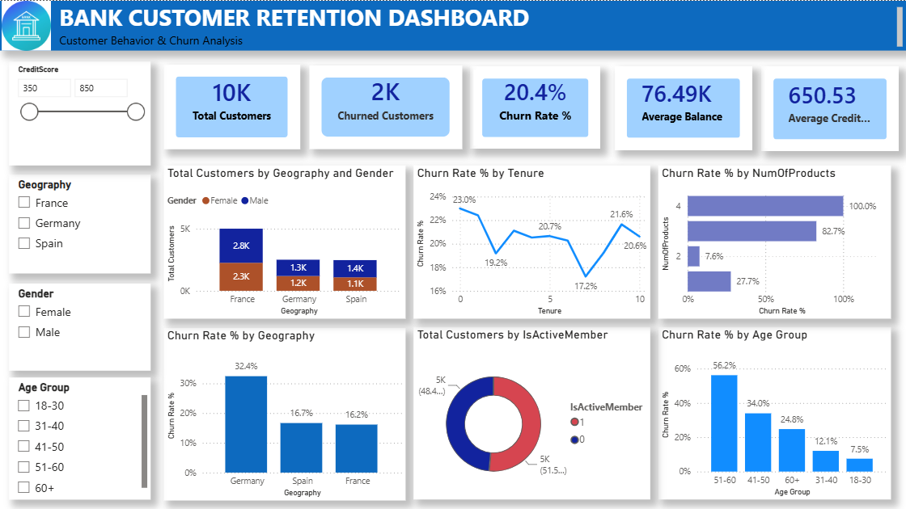

# 🏦 Bank Customer Retention Dashboard | Power BI

An interactive business intelligence dashboard built using **Microsoft Power BI** to analyse bank customer behaviour, identify churn patterns, and understand factors affecting customer retention.

The project analyses 10,000 customer records and provides insights into customer demographics, account activity, product usage, and churn behaviour.

---

## 📊 Dashboard Preview


---

## 🎯 Business Problem

Customer churn is a major challenge for banking institutions. Losing existing customers can affect revenue, profitability, and long-term business growth.

The objective of this project is to analyse customer data, identify customer segments with higher churn rates, and understand patterns that can help banks improve customer retention.

## 🎯 Project Objectives

- Analyse overall customer churn and retention.
- Identify customer segments with high churn rates.
- Understand the relationship between customer tenure and churn.
- Analyse churn based on geography, gender, and age groups.
- Examine the impact of product usage and active membership.
- Present business insights through an interactive dashboard.

## 📁 Dataset Information

**Dataset:** Bank Customer Churn Modelling (`Churn_Modelling.csv`)

**Dataset Source:** [Kaggle – Bank Customer Churn Modelling](https://www.kaggle.com/datasets/barelydedicated/bank-customer-churn-modeling)

| Attribute | Details |
|---|---|
| Total Records | 10,000 |
| Geography | France, Germany, Spain |
| Gender | Female, Male |
| Target Variable | Exited |
| Customer Status | Retained / Churned |

**Target Variable:**
- `0` – Customer retained.
- `1` – Customer churned.

The dataset contains customer information such as credit score, age, tenure, balance, number of products, active membership, and estimated salary.

## 🛠️ Tools & Technologies

- **Microsoft Power BI** – Dashboard development and visualization.
- **Power Query** – Data preparation and transformation.
- **DAX** – Measures and KPI calculations.
- **Data Analysis** – Customer segmentation and churn analysis.
- **Data Visualization** – Interactive charts, graphs, and KPI cards.

## 📈 Key Performance Indicators (KPIs)

| KPI | Result |
|---|---:|
| Total Customers | 10,000 |
| Churned Customers | Approximately 2,000 |
| Churn Rate | 20.4% |
| Average Balance | 76.49K |
| Average Credit Score | 650.53 |

## 📊 Dashboard Features & Analysis

### 1. Customer Distribution by Geography and Gender
Analyses customer distribution across France, Germany, and Spain, segmented by gender.

### 2. Churn Rate by Tenure
Shows how customer churn rates vary according to the number of years customers have stayed with the bank.

### 3. Churn Rate by Number of Products
Compares churn rates across customers using different numbers of banking products.

### 4. Churn Rate by Geography
Identifies geographical regions with higher customer churn.

### 5. Customer Distribution by Active Membership
Compares customers based on their active membership status.

### 6. Churn Rate by Age Group
Identifies age groups with higher customer churn rates.

## 🔍 Key Business Insights

Based on the dashboard analysis:

1. **Overall Churn:** Approximately 20.4% of customers have left the bank.
2. **Geographical Churn:** Germany has the highest churn rate at approximately 32.4%, compared with Spain at 16.7% and France at 16.2%.
3. **Age Group:** Customers aged 51–60 show the highest churn rate at approximately 56.2%.
4. **Product Usage:** Customers with four products show a particularly high churn rate in the dataset.
5. **Customer Tenure:** Churn rates fluctuate across different customer tenure periods.
6. **Customer Activity:** The dashboard shows the distribution of active and inactive customers.

## 💡 Business Recommendations

Based on the observed patterns, the bank could consider:

- Investigating customer dissatisfaction and service issues in Germany.
- Developing targeted retention campaigns for customers aged 51–60.
- Reviewing product usage and customer experience among customers with multiple products.
- Monitoring customer satisfaction at different stages of tenure.
- Encouraging inactive customers to engage with banking services.

These are suggested actions based on observed patterns, not proven causes of churn.

## 📂 Project Structure

```text
Bank-Customer-Retention-Dashboard/
│
├── Dataset/
│   └── Churn_Modelling.csv
│
├── Dashboard/
│   └── Bank_Customer_Retention.pbix
│
├── Screenshots/
│   └── dashboard.png
│
└── README.md
```

## 🚀 How to Use This Project

1. Clone or download this repository.
2. Open the `Dashboard` folder.
3. Open `Bank_Customer_Retention.pbix` using Microsoft Power BI Desktop.
4. If Power BI asks for the dataset location, update the source path to the CSV file inside the `Dataset` folder.
5. Refresh the data if required.
6. Explore the dashboard using the available filters and visualizations.

**Note:** Microsoft Power BI Desktop is required to open and interact with the `.pbix` file.

## 📚 What I Learned

Through this project, I gained practical experience in:

- Building interactive dashboards using Power BI.
- Analysing customer behaviour and churn patterns.
- Working with business KPIs.
- Creating data visualizations for business analysis.
- Presenting analytical findings in a business-oriented format.

## 👩‍💻 Author

**Mamta Yadav**

Data Science Student | Aspiring Data Analyst

- GitHub: [Mamtayadav28](https://github.com/Mamtayadav28)
- Project: Bank Customer Retention Dashboard

---

⭐ If you find this project useful, consider giving this repository a star!
